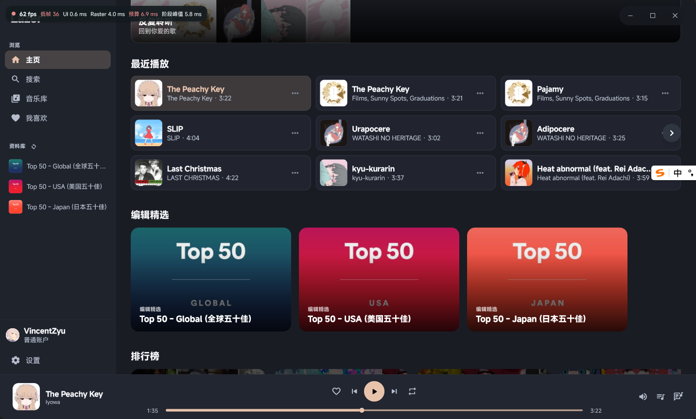
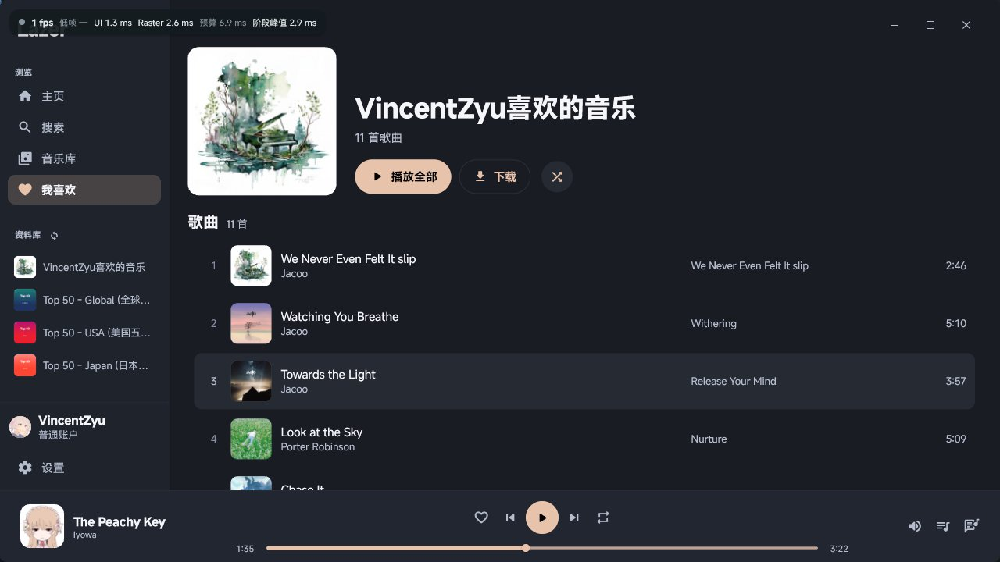
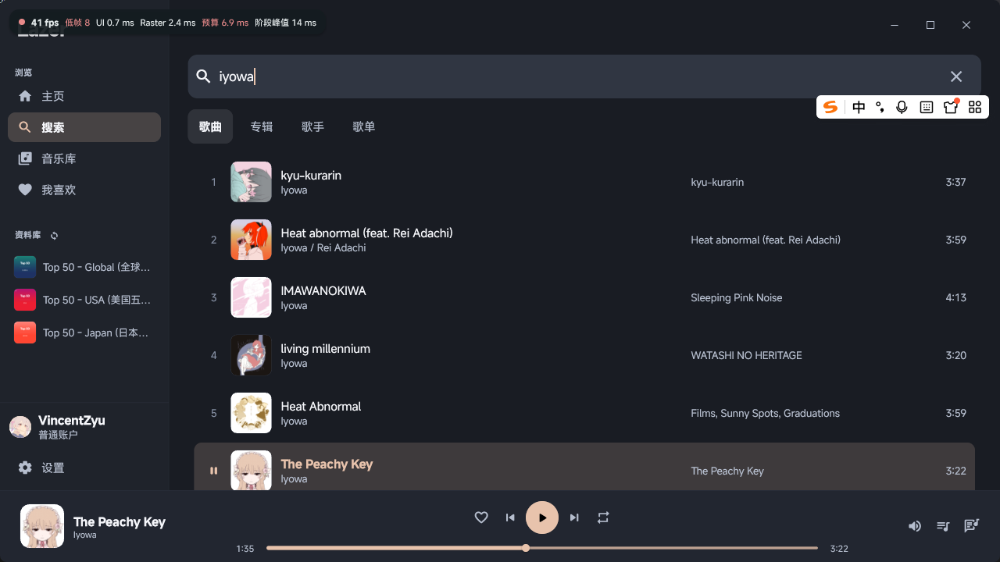
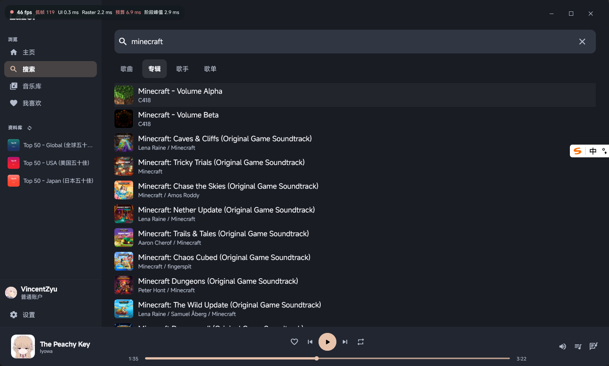
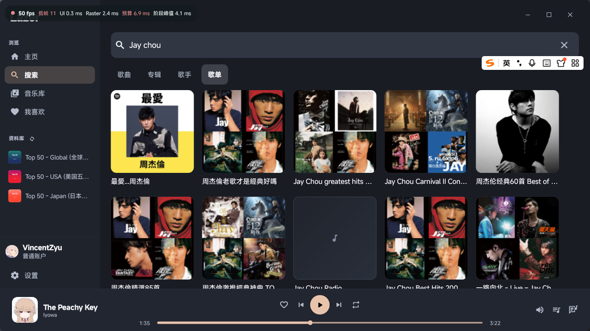
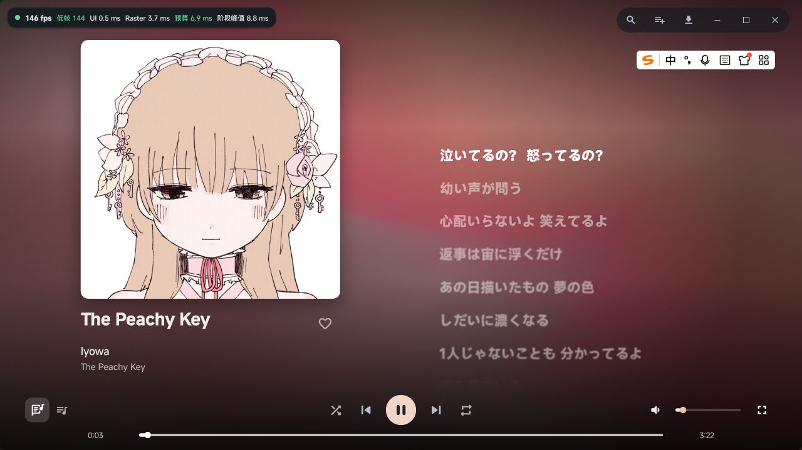
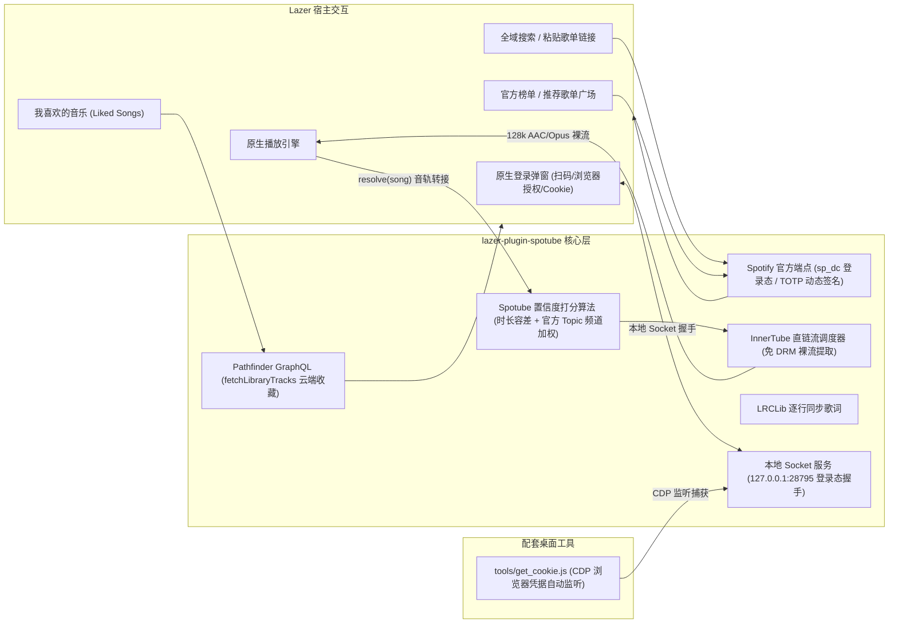
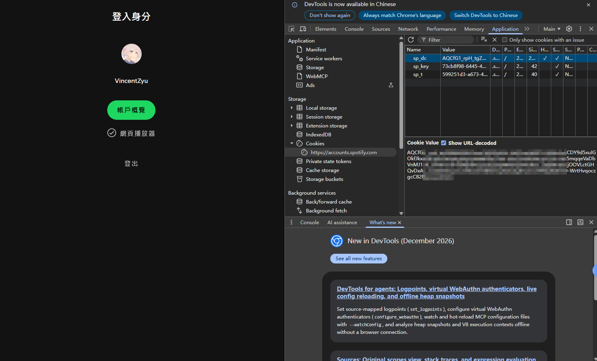

# 🎵 Lazer Spotube Music Plugin (Spotify 曲库插件)

[](LICENSE)
[](manifest.json)
[](https://github.com/chuxuehaocai/Lazer)

专为 [**Lazer**](https://github.com/chuxuehaocai/Lazer) 现代跨平台音乐播放器打造的 **Spotube (Spotify) 官方/第三方 Lua Gateway 扩展插件**。

支持免登录访客体验，更深度支持**浏览器联动登录**与**全自动凭据注入工具**，直接将 **Spotify 全球曲库、官方榜单、个人歌单与算法精选** 无缝融入 Lazer！

---

## ✨ 特性亮点

- **双源混合架构（Spotube = Spotify + YouTube）**：
  - 核心架构深度对齐 [team-spotube/spotube](https://github.com/team-spotube/spotube) 开源项目，将 Spotify 官方权威元数据与 YouTube 纯净音频流无缝融合，免登录畅享全球公共曲库、算法歌单与官方榜单。
- **「我喜欢」云端红心曲库实时同步（Favorites / Liked Songs）**：
  - 深度逆向对接 Spotify 内部 Pathfinder GraphQL 协议（`fetchLibraryTracks` 端点与 clientToken 机制），完美实现个人 Spotify 账号云端红心曲库双向同步。
  - 自动解析并展示高清专辑封面、艺人信息、歌曲时长，底栏红心收藏与取消秒级无感同步。
- **Spotube 原生置信度智能转接（Confidence Matcher）**：
  - 核心打分算法严格对齐 Spotube 官方实现，结合**标题核心词归一化、艺人交叉比对、$\le 10s$ 录音室原版时长容差**以及 **YouTube 官方 "- Topic" 纯音频频道优先** 规则进行多重加权打分，精准消除 MV 杂音与翻唱干扰。
- **双重登录体验与自动化配套工具（Dual-Mode Auth）**：
  - **原生网页/扫码授权**：在 Lazer 登录弹窗中点击【在浏览器中打开授权页】直接唤起系统默认浏览器登录 Spotify。
  - **全自动凭据抓取与实时注入（tools/get_cookie.js）**：配套提供跨平台纯原生 Node.js 自动化助手，运行即可拉起独立浏览器窗口完成登录，通过 CDP 协议自动提取 `sp_dc` 凭据并通过本地 Socket (`127.0.0.1:28795`) 实时通知 Lazer 客户端秒速完成登录并自动关闭弹窗！
  - **传统 Cookie 模式**：亦可直接在 Cookie 标签页粘贴 `sp_dc` 的值完成快速鉴权。
- **全域曲库检索与公开歌单直链秒开**：
  - 深度逆向 Spotify 官方端点，支持单曲、艺人、专辑、公共歌单多维度全域检索。
  - 支持在 Lazer 搜索框直接粘贴任意公开 Spotify 歌单链接（`open.spotify.com/playlist/...`）一键载入整张歌单。
- **免 DRM 高保真直链流（Anti-Throttling Stream）**：
  - 智能调度移动端未加密的 128kbps AAC / Opus 裸音频直链，免去复杂的 Widevine 解密模块与 JS 解密开销，保持插件仅 **数十 KB** 的极简轻量包体，流量缓冲持续超越播放速率。
- **精准毫秒级逐行滚动歌词（Live Lyrics）**：
  - 深度对接公开免鉴权同步歌词源（LRCLib），毫秒级逐行滚动，完美呈现 Lazer 流光高亮背景。
- **轻量独立**：纯 Lua 实现，无额外 Python / 原生动态库依赖，打包体积仅 47 KB。

---

## 📸 界面预览 (Preview)

### 📻 1. 主页发现与官方榜单 (Home Feed & Charts)
深度整合 Spotify 官方全球热门榜单（Global, USA, Japan Top 50）与猜你喜欢、编辑精选展架，卡片流光溢彩，常驻主页中心。


### ❤️ 2. 红心收藏与我喜欢的音乐 (Favorites / Liked Songs)
基于 Spotify Pathfinder GraphQL 内部协议，完美无感双向同步个人 Spotify 账号云端“我喜欢”红心曲库，自动渲染高清封面、艺人信息与时长。


### 🔍 3. 单曲全域搜索 (Song Search)
多维度检索官方单曲与高精准匹配，毫秒级呈现音轨元数据与高清封面。


### 💿 4. 专辑搜索与全盘试听 (Album Search)
支持独立专辑 Tab 检索，呈现完整的唱片发行信息与官方音轨列表，支持一键载入全盘试听。


### 📑 5. 歌单搜索与直接秒开 (Playlist Search)
检索丰富的公共精选歌单与分类特辑，支持直接在搜索框粘贴公开 Spotify 歌单链接（`open.spotify.com/playlist/...`）秒开整张歌单。


### 🎤 6. 纯净毫秒级流光同步歌词 (Timed Lyrics)
深度对接 LRCLIB 免鉴权同步歌词源，毫秒级逐行滚动，完美呈现 Lazer 流光高亮背景。


---

## 🛠️ 架构原理解析 (Architecture)

本插件借鉴了开源播放器 **Spotube** 的经典设计，采用双轨互补分层架构：



---

## 🔐 登录体验与配套工具 (Authentication)

Spotify 采用严格的 HttpOnly Cookie (`sp_dc`) 进行 Web 播放鉴权。本插件提供两种便捷的登录体验：

### 方案 A：一键助手自动注入 (最省心，默认推荐)
1. 进入插件目录下的 `tools/` 文件夹；
2. 在终端或控制台直接运行：
   ```bash
   node tools/get_cookie.js
   ```
3. 脚本会自动拉起独立的浏览器窗口引导登录；登录成功后，脚本会自动提取 `sp_dc`、解析用户身份、注入到 Lazer 插件存储，并通知 Lazer 客户端自动完成登录并关闭弹窗！

### 方案 B：浏览器开发者工具手动提取 Cookie (通用方案)
如果您希望直接复用日常 Chrome / Edge 浏览器中已登录的 Spotify 账号：
1. 在日常浏览器中打开并登录 [accounts.spotify.com](https://accounts.spotify.com)（或在 Lazer 登录弹窗中点击【在浏览器中打开授权页】）；
2. 登录成功后，按键盘 **`F12`** 键（或右键选择“检查”）打开开发者工具（DevTools）；
3. 切换到顶部的 **`Application`（应用）** 标签页；
4. 在左侧菜单栏展开 **`Storage`（存储）** ➔ **`Cookies`** ➔ 点击 **`https://accounts.spotify.com`**；
5. 在右侧列表中找到名称为 **`sp_dc`** 的条目，双击复制其 **`Value`（值）**；
6. 回到 Lazer 客户端 Spotube 登录弹窗，点击底部的 **【使用 Cookie 登录】**，将复制的 `sp_dc` 粘贴进去确认即可秒级完成登录！



---

## 📦 安装使用指南 (Installation)

### 🛒 方法一：通过官方插件市场安装（推荐）

Spotube 插件现已提交收录于 Lazer 官方插件市场：
1. 打开 **Lazer** 播放器，进入 **设置 -> 插件管理 -> 插件市场**。
2. 在市场中找到或搜索 **“Spotube”** (`lazer.spotube`)。
3. 点击 **安装** 即可完成自动下载与激活，支持后续版本无感自动热更新！
4. 在播放器音源切换列表选择 **Spotube** 即可尽情聆听。

### 📥 方法二：通过 ZIP 本地导入

1. 前往本仓库的 [Releases](../../releases) 页面，下载最新的 `lazer.spotube.zip`。
2. 打开 **Lazer** 播放器，进入 **设置 -> 插件管理**。
3. 点击 **导入 ZIP 插件**，选择下载好的 `lazer.spotube.zip`。
4. 启用插件后，在播放器音源切换列表即可选择 **Spotube**！

---

## 🛠️ 本地构建与打包

项目内置了 Node.js 一键校验与打包脚本：

```bash
# 校验清单并打包为 dist/lazer.spotube.zip，同时输出 SHA-256 和 plugins.json 片段
node tools/build.js
```

产物将自动输出至 `dist/lazer.spotube.zip`，并生成对应的 SHA-256 哈希值。

---

## 💖 鸣谢与致敬

- [chuxuehaocai/Lazer](https://github.com/chuxuehaocai/Lazer) - 优雅而纯粹的手工打造跨平台音乐播放器（AGPL-3.0），为本项目提供了核心扩展宿主与运行时环境。
- [team-spotube/spotube](https://github.com/team-spotube/spotube) - 卓越的开源跨平台 Spotify 客户端（AGPL-3.0），为本插件的置信度匹配算法（Confidence Matcher）与双轨架构设计提供了核心灵感。
- [LRCLIB](https://lrclib.net) - 纯净、免鉴权的开放同步歌词数据库（MIT），为本项目提供了毫秒级滚动歌词源支撑。

---

## 📄 开源许可证

本项目基于 **[GNU Affero General Public License v3.0 (AGPL-3.0)](LICENSE)** 协议开源，与 [Lazer](https://github.com/chuxuehaocai/Lazer) 宿主本体及 [Spotube](https://github.com/team-spotube/spotube) 生态完全对齐。仅供技术学习与交流使用，音频元数据及流媒体版权归 Spotify、YouTube 及相关版权方所有。
