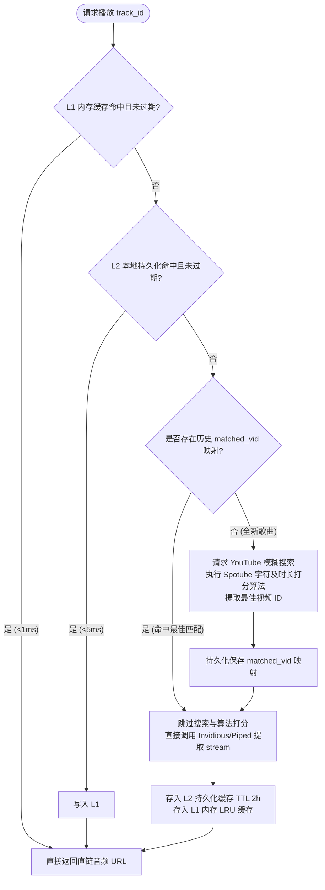

# v0.2.0 P0 核心能力落地设计与开发规划

> **文档状态**：待执行（Approved Planning）  
> **创建时间**：2026-11-27 22:05:00  
> **目标版本**：`v0.2.0`  
> **关联规划**：[20261127_213200_基于SpotAPI与Spotube官方架构的多梯队功能演进与体验优化规划.md](file:///D:/aaaStuffsaaa/from_git/github/lazer-plugin-spotube/docs/plan/20261127_213200_基于SpotAPI与Spotube官方架构的多梯队功能演进与体验优化规划.md)  
> **目标工程**：`lazer-plugin-spotube`

---

## 1. 目标与背景

在 `v0.1.5` 中，`lazer.spotube` 已经成功完成了：
- 规范化插件 ID 与包结构；
- Spotify OAuth2 授权登录（包括 PKCE 与 Token 自动刷新）；
- 基础搜索（单曲、专辑、歌单）以及歌单/专辑内歌曲浏览与播放；
- 基于 Spotube 算法的多维度 YouTube 音频匹配。

但在实际使用与对标官方 Spotube / 其他 Lazer 音乐插件时，当前仍有三大最直接影响听歌体验的核心痛点亟需解决：
1. **云端资产缺失**：用户登录后无法在“我的歌单”看到自己收藏和创建的 Spotify 歌单，仅能手动输入关键词搜索。
2. **艺人链路断裂**：点击单曲作者无法展开艺人详情页，缺少艺人热门 Top 10、艺人专辑与单曲档案浏览能力。
3. **切歌解析耗时高与风控风险**：切歌、重放、循环播放时每次都必须重新触发 YouTube 搜索 + 标题打分匹配，导致 1.5s~3s 的播放停顿，且短时间内高频切歌容易触发 YouTube 的 HTTP 429 速率限制。

因此，**`v0.2.0` 的核心使命即是集中全部精力攻坚 P0 级三大基础体验**：
- **P0.1 用户云端歌单资产拉取 (`userPlaylists`)**
- **P0.2 艺人详情、热门单曲与专辑档案 (`artistDetails` / `artistSongs` / `artistAlbums`)**
- **P0.3 双层音频流缓存机制与视频 ID 记忆系统 (L1 Memory + L2 Store + VideoId Mapping)**

---

## 2. 详细功能契约与协议规范

### 2.1 P0.1 用户云端歌单 (`userPlaylists`)

#### 契约规范
- **Capability 标识**：`"userPlaylists"`
- **调用入口**：`plugin.call("userPlaylists", params)`
- **请求参数**：
  ```lua
  {
      limit = 50,    -- 默认 50，单页数量
      offset = 0     -- 分页偏移量
  }
  ```
- **Spotify Web API 交互**：
  - 端点：`GET https://api.spotify.com/v1/me/playlists?limit={limit}&offset={offset}`
  - 请求头：`Authorization: Bearer <access_token>`
  - 容错处理：若尚未登录或 Token 过期，先触发刷新；若未登录则返回清晰错误提示。
- **返回数据结构**：
  ```lua
  {
      list = {
          {
              id = "37i9dQZF1DXcBWIGoYBM5M",
              title = "Today's Top Hits",
              name = "Today's Top Hits",
              coverUrl = "https://i.scdn.co/image/...",
              songCount = 50,
              owner = "Spotify",
              description = "Jung Kook is on top of the Hottest 50!"
          },
          -- ...
      },
      total = 12,
      hasMore = false
  }
  ```

---

### 2.2 P0.2 艺人主页生态链

#### (1) 艺人基本详情 (`artistDetails`)
- **Capability 标识**：`"artistDetails"`
- **请求参数**：`{ id = "06HL4z0CvFAxyc27GXpf02" }`（Taylor Swift）
- **Spotify 端点**：`GET https://api.spotify.com/v1/artists/{id}`
- **返回数据结构**：
  ```lua
  {
      id = "06HL4z0CvFAxyc27GXpf02",
      name = "Taylor Swift",
      avatarUrl = "https://i.scdn.co/image/...",
      followers = 112000000,
      genres = { "pop" },
      description = "Pop / Country singer-songwriter"
  }
  ```

#### (2) 艺人热门单曲 (`artistSongs`)
- **Capability 标识**：`"artistSongs"`
- **请求参数**：`{ id = "06HL4z0CvFAxyc27GXpf02", limit = 50, offset = 0 }`
- **Spotify 端点**：`GET https://api.spotify.com/v1/artists/{id}/top-tracks?market=from_token`
- **返回数据结构**：标准 `Song[]` 数组，每项携带 `id`, `name`, `artists`, `album`, `duration`, `coverUrl`。

#### (3) 艺人专辑/单曲作品集 (`artistAlbums` / `browseAlbums`)
- **Capability 标识**：`"browseAlbums"`
- **请求参数**：`{ id = "06HL4z0CvFAxyc27GXpf02", limit = 50, offset = 0 }`
- **Spotify 端点**：`GET https://api.spotify.com/v1/artists/{id}/albums?include_groups=album,single&limit={limit}&offset={offset}`
- **返回数据结构**：标准 `Album[]` 数组。

---

### 2.3 P0.3 双层音频流缓存与视频 ID 记忆系统

为了彻底消除切歌、上一首、下一首时的重复请求延迟与 429 风险，建立 **L1 内存缓存 + L2 持久化缓存 + L3 视频 ID 永久映射** 三级立体加速架构。



#### 关键技术参数设计
1. **L1 内存缓存**：
   - 容量：64 首近期播放。
   - 结构：基于 Lua Table 实现的高速双向链表/哈希 LRU 容器。
   - 耗时：`< 1ms`。
2. **L2 本地持久化缓存**：
   - 存储 Key：`stream_cache:<track_id>`
   - 存储 Payload：`{ url = "https://...", expire_at = 1718000000, video_id = "..." }`
   - **有效 TTL**：`7200 秒（2 小时）`。虽然 YouTube 直链有效期通常为 6 小时，但预留 4 小时安全裕度可确保直链绝对可用，避免播放到后半段出现 403 Forbidden。
3. **L3 永久视频 ID 映射 (Permanent Matched VideoID)**：
   - 存储 Key：`matched_vid:<track_id>`
   - 存储 Payload：`"dQw4w9WgXcQ"`
   - 优势：当 2 小时后音频直链过期时，再次播放此歌曲时**不需要重新请求 YouTube 检索并比对打分**（此步骤通常消耗 1.5s 以上并消耗配额），而是直接使用已记录的最佳视频 ID 解析最新直链（耗时缩短至 200~300ms）。

---

## 3. 架构设计与工程目录树 (`v0.2.0`)

在保持单一职责与模块化清晰度的原则下，升级后的工程结构如下：

```
lazer-plugin-spotube/
├── manifest.json                                # 插件元数据，版本升级至 0.2.0，注册新 capabilities
├── main.lua                                     # 统一路由入口，分发 userPlaylists、artist 等调用
├── README.md                                    # 保持双语说明与 3 枚统一规范徽标
│
├── spotube/
│   ├── init.lua                                 # 门面模块，初始化服务与依赖装配
│   │
│   ├── core/
│   │   ├── http.lua                             # HTTP 客户端封装（超时、User-Agent、网络异常包装）
│   │   ├── store.lua                            # 持久化 Store 封装（lazer 提供的存储 API 抽象）
│   │   ├── cache.lua                            # [新增] L1 内存 LRU 队列与 L2 持久化调度引擎
│   │   └── utils.lua                            # 字符串清洗、时间解析、模糊匹配工具
│   │
│   ├── models/
│   │   ├── track.lua                            # Spotify Track -> Lazer Song 模型映射
│   │   ├── playlist.lua                         # Spotify Playlist -> Lazer Playlist 模型映射
│   │   ├── album.lua                            # Spotify Album -> Lazer Album 模型映射
│   │   └── artist.lua                           # [新增] Spotify Artist -> Lazer Artist 模型映射
│   │
│   └── services/
│       ├── spotify.lua                          # [扩展] 增加 get_user_playlists, get_artist_* 方法
│       ├── youtube.lua                          # YouTube / Invidious / Piped 音频源检索与解析
│       ├── matcher.lua                          # Spotube 权重打分算法（Title、Artist、Duration 匹配）
│       └── stream.lua                           # [重构] 串联 Cache -> VideoID -> Matcher -> Direct Stream
│
├── tests/                                       # 单元测试与验证套件
│   ├── run_tests.lua                            # 测试启动器
│   ├── test_cache.lua                           # [新增] 测试 L1/L2 写入、过期、LRU 淘汰逻辑
│   ├── test_artist.lua                          # [新增] 测试艺人数据模型映射正确性
│   └── test_user_playlists.lua                  # [新增] 测试用户歌单解析与分页
│
└── docs/
    └── plan/
        ├── 20261127_213200_基于SpotAPI与Spotube官方架构的多梯队功能演进与体验优化规划.md
        └── 20261127_220500_v0.2.0_P0核心能力落地设计与开发规划.md
```

---

## 4. 关键模块实现方案与伪代码设计

### 4.1 `spotube/core/cache.lua`（双层缓存引擎）

```lua
local store = require("spotube.core.store")

local Cache = {}
local L1_MAX_SIZE = 64
local DEFAULT_STREAM_TTL = 7200 -- 2 小时

local l1_cache = {} -- key -> { val = ..., expire_at = ... }
local l1_keys = {}  -- LRU 队列

local function now()
    return os.time()
end

-- 获取缓存直链
function Cache.get_stream(track_id)
    local cur_time = now()
    
    -- 1. 检查 L1 内存
    local l1_entry = l1_cache[track_id]
    if l1_entry then
        if l1_entry.expire_at > cur_time then
            return l1_entry.url, l1_entry.video_id
        else
            l1_cache[track_id] = nil
        end
    end
    
    -- 2. 检查 L2 持久化
    local l2_raw = store.get("stream_cache:" .. track_id)
    if l2_raw then
        local ok, data = pcall(json.decode, l2_raw)
        if ok and data and data.expire_at and data.expire_at > cur_time then
            -- 回填 L1
            Cache.set_l1(track_id, data.url, data.video_id, data.expire_at)
            return data.url, data.video_id
        else
            store.delete("stream_cache:" .. track_id)
        end
    end
    
    return nil, nil
end

-- 写入音频直链（同时更新 L1 与 L2）
function Cache.set_stream(track_id, url, video_id, ttl)
    local expire_at = now() + (ttl or DEFAULT_STREAM_TTL)
    
    -- 更新 L1
    Cache.set_l1(track_id, url, video_id, expire_at)
    
    -- 更新 L2
    local l2_payload = json.encode({
        url = url,
        video_id = video_id,
        expire_at = expire_at
    })
    store.set("stream_cache:" .. track_id, l2_payload)
    
    -- 永久保留 video_id 映射
    if video_id then
        Cache.set_matched_vid(track_id, video_id)
    end
end

-- 获取已记录的历史最佳匹配 Video ID
function Cache.get_matched_vid(track_id)
    return store.get("matched_vid:" .. track_id)
end

function Cache.set_matched_vid(track_id, video_id)
    store.set("matched_vid:" .. track_id, video_id)
end

return Cache
```

### 4.2 `spotube/services/spotify.lua`（新增 API 扩展）

```lua
-- 1. 获取用户歌单
function Spotify.get_user_playlists(limit, offset)
    limit = limit or 50
    offset = offset or 0
    local url = string.format("https://api.spotify.com/v1/me/playlists?limit=%d&offset=%d", limit, offset)
    local res = Spotify.request("GET", url)
    if not res or not res.items then
        return { list = {}, total = 0, hasMore = false }
    end
    
    local playlists = {}
    for _, item in ipairs(res.items) do
        table.insert(playlists, PlaylistModel.from_spotify(item))
    end
    
    return {
        list = playlists,
        total = res.total or #playlists,
        hasMore = (offset + limit) < (res.total or 0)
    }
end

-- 2. 艺人详情
function Spotify.get_artist(artist_id)
    local url = "https://api.spotify.com/v1/artists/" .. artist_id
    local res = Spotify.request("GET", url)
    if not res then return nil end
    return ArtistModel.from_spotify(res)
end

-- 3. 艺人热门单曲
function Spotify.get_artist_top_tracks(artist_id)
    local url = "https://api.spotify.com/v1/artists/" .. artist_id .. "/top-tracks?market=from_token"
    local res = Spotify.request("GET", url)
    if not res or not res.tracks then return {} end
    
    local tracks = {}
    for _, item in ipairs(res.tracks) do
        table.insert(tracks, TrackModel.from_spotify(item))
    end
    return tracks
end

-- 4. 艺人作品集/专辑
function Spotify.get_artist_albums(artist_id, limit, offset)
    limit = limit or 50
    offset = offset or 0
    local url = string.format(
        "https://api.spotify.com/v1/artists/%s/albums?include_groups=album,single&limit=%d&offset=%d",
        artist_id, limit, offset
    )
    local res = Spotify.request("GET", url)
    if not res or not res.items then return { list = {}, total = 0, hasMore = false } end
    
    local albums = {}
    for _, item in ipairs(res.items) do
        table.insert(albums, AlbumModel.from_spotify(item))
    end
    return {
        list = albums,
        total = res.total or #albums,
        hasMore = (offset + limit) < (res.total or 0)
    }
end
```

### 4.3 `manifest.json` 能力扩展清单

在 `manifest.json` 的 `capabilities` 声明中，加入 P0 落地的新增能力：

```json
{
  "id": "lazer.spotube",
  "name": "Spotube",
  "version": "0.2.0",
  "capabilities": [
    "search",
    "playlist",
    "album",
    "stream",
    "lyrics",
    "userPlaylists",
    "artistDetails",
    "artistSongs",
    "browseAlbums"
  ]
}
```

---

## 5. 实施落地步骤与排期计划

实施分为四个紧密相扣的交付阶段：

| 阶段 | 任务目标 | 核心产出文件 | 预期工时 | 验证手段 |
| :--- | :--- | :--- | :--- | :--- |
| **Stage 1** | **双层缓存架构搭建** | `core/cache.lua`<br/>`tests/test_cache.lua` | 1 轮 | 单元测试验证 L1 命中、L2 持久化读写、TTL 淘汰及 LRU 满载剔除 |
| **Stage 2** | **Spotify 艺人与歌单扩展** | `models/artist.lua`<br/>`services/spotify.lua` | 1 轮 | 测试脚本模拟 Spotify 响应，验证字段对齐与分页边界 |
| **Stage 3** | **流媒体解析串联优化** | `services/stream.lua`<br/>`services/youtube.lua` | 1 轮 | 模拟同一首歌曲连续调用 3 次：首次搜索打分，二次秒开（L1），模拟重启秒开（L2） |
| **Stage 4** | **主入口路由与 Manifest 更新** | `main.lua`<br/>`manifest.json`<br/>`README.md` | 1 轮 | 全量插件端对端测试，打包并生成 0.2.0 发布工件 |

---

## 6. 风险评估与防御策略

1. **YouTube 直链跨 IP 或跨域名限制**：
   - *风险*：部分 Invidious/Piped 实例生成的视频音频流带签名字段，可能绑定特定 IP 或在短时间失效。
   - *防御*：L2 缓存时长设置为保守的 2 小时；一旦音频流在前端播放报错，支持优雅降级（播放失败时主动清除对应 `stream_cache:<track_id>` 并触发自动重试）。
2. **Spotify Token 过期与未登录态防护**：
   - *风险*：访问 `/v1/me/playlists` 需要有效的用户 OAuth Token，未登录状态下直接调用会返回 401。
   - *防御*：在 `services/spotify.lua` 调用 `me` 相关接口前，先检查 `store.get("access_token")`。若未登录，返回友好提示引导用户在插件设置或登录面板完成授权。
3. **L1 内存占用控制**：
   - *风险*：长时间挂机播放海量歌曲导致内存泄漏。
   - *防御*：严格限制 L1 字典最大槽数为 64（约消耗几 KB 内存），超出后自动剔除最早未访问的项目。
